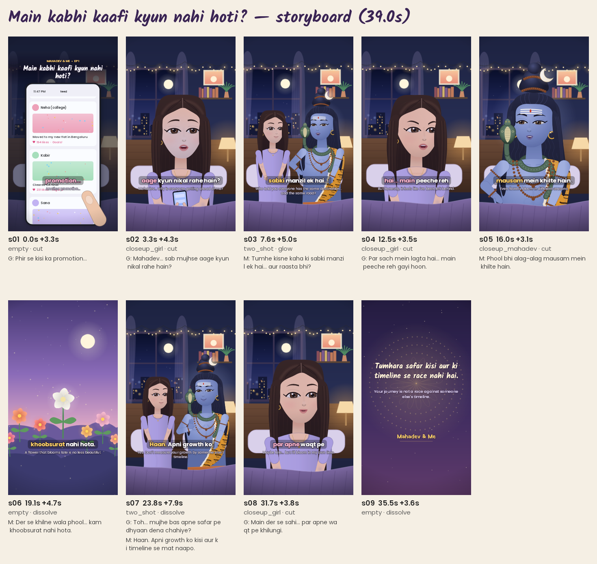

# Main kabhi kaafi kyun nahi hoti?  ·  _Why am I never enough?_

**Series:** Mahadev & Me — Episode 1  
**Pillar:** comparison_self_worth  
**Target audience:** 18-30, students & early-career professionals comparing themselves on social media  
**Core problem:** Scrolling through peers' promotions and new jobs makes her feel left behind.  
**Intended moral:** Tumhara safar kisi aur ki timeline se race nahi hai. — _Your journey is not a race against someone else's timeline._  
**Attribution:** Original fiction. The flower analogy is our own metaphor, not a scriptural teaching.  
**Music direction:** night_reflective (procedural tanpura drone, soft pad, sparse bells; swell at the realisation)  
**Subtitles:** hinglish+english  
**Voices:** {'girl': 'girl_preview', 'mahadev': 'mahadev_preview'}  
**Measured runtime:** 39.05 s  

## Shots

### s01 — insert_phone_feed · bedroom_night · empty  (0.0–3.3 s)

*Scene:* Close-up of her phone at 11:47 PM: friends' promotions, offer letters, new flats scroll past under her thumb.  
*Camera:* Static insert with slow push-in; thumb flicks the feed.  
- **GIRL (V.O.)** _(disappointed)_ [1.9s]: Phir se kisi ka promotion...  
  फिर से किसी का प्रमोशन...  
  _Another promotion..._

### s02 — dialogue · bedroom_night · closeup_girl  (3.3–7.6 s)

*Scene:* Her face lit by the phone, on her bed under fairy lights. She looks up from the screen.  
*Camera:* slow push-in (1.00→1.06); transition in: cut  
- **GIRL** _(sad)_ [3.1s]: Mahadev... sab mujhse aage kyun nikal rahe hain?  
  महादेव... सब मुझसे आगे क्यों निकल रहे हैं?  
  _Mahadev... why is everyone getting ahead of me?_

### s03 — dialogue · bedroom_night · two_shot  (7.6–12.5 s)

*Scene:* Golden motes gather; Mahadev appears sitting beside her on the bed, smiling gently.  
*Camera:* slow pull-out (1.08→1.00); transition in: glow  
- **MAHADEV** _(compassionate, explain)_ [3.4s]: Tumhe kisne kaha ki sabki manzil ek hai... aur raasta bhi?  
  तुम्हें किसने कहा कि सबकी मंज़िल एक है... और रास्ता भी?  
  _Who told you everyone has the same destination... and the same road?_

### s04 — dialogue · bedroom_night · closeup_girl  (12.5–16.0 s)

*Camera:* slow push-in (1.00→1.05); transition in: cut  
- **GIRL** _(frustrated)_ [2.8s]: Par sach mein lagta hai... main peeche reh gayi hoon.  
  पर सच में लगता है... मैं पीछे रह गई हूँ।  
  _But honestly, it feels like I've been left behind._

### s05 — dialogue · bedroom_night · closeup_mahadev  (16.0–19.1 s)

*Camera:* slow push-in (1.00→1.05); transition in: cut  
- **MAHADEV** _(calm, explain)_ [2.5s]: Phool bhi alag-alag mausam mein khilte hain.  
  फूल भी अलग-अलग मौसम में खिलते हैं।  
  _Even flowers bloom in different seasons._

### s06 — metaphor_flowers · dream_garden · empty  (19.1–23.8 s)

*Scene:* Dream garden at twilight: flowers already open; one white night-jasmine bud slowly blooms, glowing.  
*Camera:* slow push-in (1.00→1.12); transition in: dissolve  
- **MAHADEV (V.O.)** _(compassionate)_ [3.5s]: Der se khilne wala phool... kam khoobsurat nahi hota.  
  देर से खिलने वाला फूल... कम ख़ूबसूरत नहीं होता।  
  _A flower that blooms late is no less beautiful._

### s07 — dialogue · bedroom_night · two_shot  (23.8–31.7 s)

*Camera:* slow push-in (1.00→1.05); transition in: dissolve  
- **GIRL** _(curious)_ [3.3s]: Toh... mujhe bas apne safar pe dhyaan dena chahiye?  
  तो... मुझे बस अपने सफ़र पे ध्यान देना चाहिए?  
  _So... I should just focus on my own journey?_
- **MAHADEV** _(smile, abhaya)_ [3.5s]: Haan. Apni growth ko kisi aur ki timeline se mat naapo.  
  हाँ। अपनी ग्रोथ को किसी और की टाइमलाइन से मत नापो।  
  _Yes. Don't measure your growth by someone else's timeline._

### s08 — dialogue · bedroom_night · closeup_girl  (31.7–35.5 s)

*Scene:* She sets the phone face-down in her lap and smiles – the realisation.  
*Camera:* slow push-in (1.00→1.08); transition in: cut  
- **GIRL** _(hopeful)_ [3.1s]: Main der se sahi... par apne waqt pe khilungi.  
  मैं देर से सही... पर अपने वक़्त पे खिलूँगी।  
  _Maybe late... but I'll bloom in my own time._

### s09 — moral · moral_card · empty  (35.5–39.1 s)

*Camera:* locked-off; transition in: dissolve  

## Social

**Caption:**

Kabhi kabhi lagta hai sab aage nikal gaye aur hum wahin ruk gaye... 🌙
Par har phool apne mausam mein khilta hai. 🌸
Tumhara safar, tumhari timeline. 🔱
(Original fictional story – Mahadev & Me)

**Hashtags:** #MahadevAndMe #Mahadev #HarHarMahadev #SelfWorth #ComparisonIsTheThiefOfJoy #HindiReels #Hinglish #SpiritualReels #Motivation #AnimatedStory #ShivaWisdom

