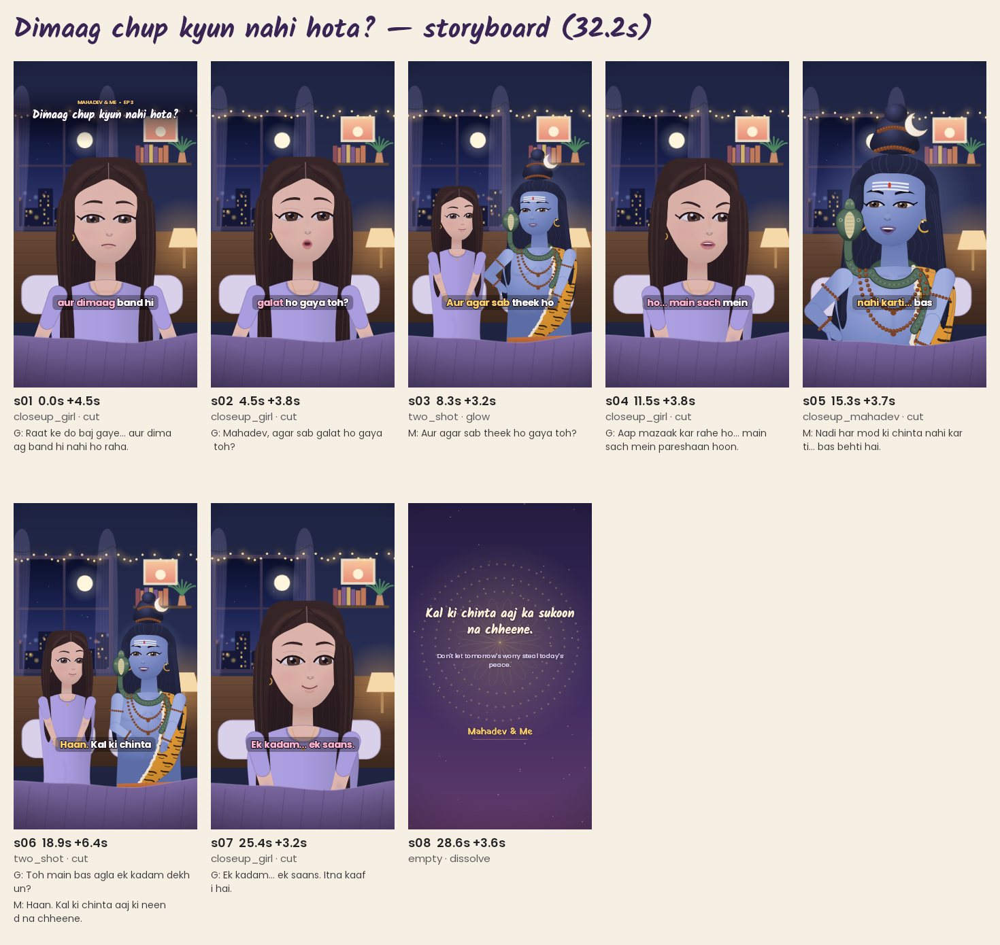

# Dimaag chup kyun nahi hota?  ·  _Why won't my mind go quiet?_

**Series:** Mahadev & Me — Episode 3  
**Pillar:** overthinking  
**Target audience:** 18-30, young Indians navigating modern-life pressure  
**Core problem:** Overthinking about my future  
**Intended moral:** Kal ki chinta aaj ka sukoon na chheene. — _Don't let tomorrow's worry steal today's peace._  
**Attribution:** Original fiction generated from the Mahadev & Me template library; not a scriptural teaching. If these feelings are heavy or constant, please talk to someone you trust or a mental-health professional (India: Tele-MANAS 14416).  
**Music direction:** night_reflective (procedural tanpura drone, soft pad, sparse bells; swell at the realisation)  
**Subtitles:** hinglish  
**Voices:** {'girl': 'girl_preview', 'mahadev': 'mahadev_preview'}  
**Measured runtime:** 32.23 s  

## Shots

### s01 — dialogue · bedroom_night · closeup_girl  (0.0–4.5 s)

*Scene:* Hook: Overthinking about my future  
*Camera:* slow push-in (1.00→1.06); transition in: cut  
- **GIRL (V.O.)** _(disappointed)_ [3.5s]: Raat ke do baj gaye... aur dimaag band hi nahi ho raha.  
  रात के दो बज गए... और दिमाग़ बंद ही नहीं हो रहा।  
  _It's 2 AM... and my mind won't switch off._

### s02 — dialogue · bedroom_night · closeup_girl  (4.5–8.3 s)

*Camera:* slow push-in (1.00→1.05); transition in: cut  
- **GIRL** _(sad)_ [2.9s]: Mahadev, agar sab galat ho gaya toh?  
  महादेव, अगर सब ग़लत हो गया तो?  
  _Mahadev, what if everything goes wrong?_

### s03 — dialogue · bedroom_night · two_shot  (8.3–11.5 s)

*Camera:* slow pull-out (1.08→1.00); transition in: glow  
- **MAHADEV** _(compassionate, explain)_ [1.7s]: Aur agar sab theek ho gaya toh?  
  और अगर सब ठीक हो गया तो?  
  _And what if everything goes right?_

### s04 — dialogue · bedroom_night · closeup_girl  (11.5–15.3 s)

*Camera:* slow push-in (1.00→1.05); transition in: cut  
- **GIRL** _(frustrated)_ [3.1s]: Aap mazaak kar rahe ho... main sach mein pareshaan hoon.  
  आप मज़ाक कर रहे हो... मैं सच में परेशान हूँ।  
  _You're joking... I'm genuinely worried._

### s05 — dialogue · bedroom_night · closeup_mahadev  (15.3–18.9 s)

*Camera:* slow push-in (1.00→1.05); transition in: cut  
- **MAHADEV** _(calm, explain)_ [3.0s]: Nadi har mod ki chinta nahi karti... bas behti hai.  
  नदी हर मोड़ की चिंता नहीं करती... बस बहती है।  
  _A river doesn't worry about every bend... it just flows._

### s06 — dialogue · bedroom_night · two_shot  (18.9–25.4 s)

*Camera:* slow push-in (1.00→1.05); transition in: cut  
- **GIRL** _(curious)_ [2.7s]: Toh main bas agla ek kadam dekhun?  
  तो मैं बस अगला एक क़दम देखूँ?  
  _So I just look at the next one step?_
- **MAHADEV** _(smile, abhaya)_ [2.7s]: Haan. Kal ki chinta aaj ki neend na chheene.  
  हाँ। कल की चिंता आज की नींद न छीने।  
  _Yes. Don't let tomorrow's worry steal tonight's sleep._

### s07 — dialogue · bedroom_night · closeup_girl  (25.4–28.6 s)

*Camera:* slow push-in (1.00→1.08); transition in: cut  
- **GIRL** _(hopeful)_ [2.6s]: Ek kadam... ek saans. Itna kaafi hai.  
  एक क़दम... एक साँस। इतना काफ़ी है।  
  _One step... one breath. That's enough._

### s08 — moral · moral_card · empty  (28.6–32.2 s)

*Camera:* locked-off; transition in: dissolve  

## Social

**Caption:**

Dimaag chup kyun nahi hota? 🔱
Kal ki chinta aaj ka sukoon na chheene.
(Original fictional story – Mahadev & Me)
If these feelings are heavy or constant, please talk to someone you trust or a mental-health professional (India: Tele-MANAS 14416).

**Hashtags:** #MahadevAndMe #Mahadev #HarHarMahadev #HindiReels #Hinglish #SpiritualReels #AnimatedStory #WhyWonTMyMindGoQuiet

